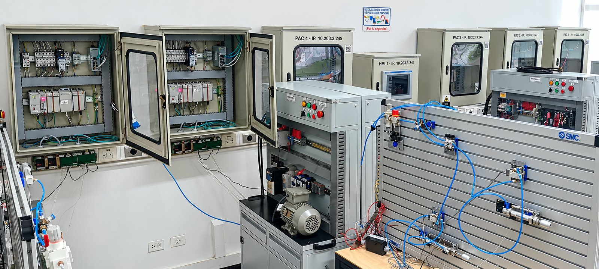
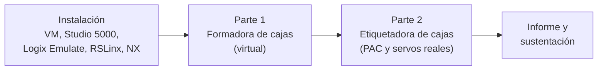

# LAM-UN · Laboratorio de Automatización de Máquinas

**Universidad Nacional de Colombia · Sede Bogotá**<br>
Facultad de Ingeniería · Departamento de Ingeniería Mecánica y Mecatrónica · Laboratorio 411-101

<p align="center">
  
</p>
<p align="center"><sub>Laboratorio 411-101: tableros de control con PAC CompactLogix (rotulados con su número y dirección IP), tablero HMI, banco de motor y panel de entrenamiento neumático.</sub></p>

---

## Bienvenida

Bienvenidos al repositorio del Laboratorio de Automatización de Máquinas. Aquí está el material práctico de los cursos que usan el laboratorio: guías, archivos de trabajo, herramientas y criterios de entrega.

El primer contenido publicado es el **Proyecto Integrador Industrial de Servomecanismos**. En él vas a programar el control de movimiento de máquinas de tres ejes en un controlador industrial Allen-Bradley y a validarlo contra su **gemelo digital** en Siemens NX Mechatronics Concept Designer (MCD). Primero lo harás en un entorno virtual y después con el PAC y los servomotores reales del laboratorio.

## Servomecanismos (2017288): Proyecto Integrador Industrial

En Servomecanismos se integran mecanismos, modelado de actuadores, control automático y electrónica de potencia para seleccionar, implementar y configurar servomecanismos. El proyecto industrial corresponde al **Resultado de Aprendizaje 4** del curso: *controlar con buen desempeño, programar en un autómata y validar una aplicación industrial con tres ejes de movimiento, dos de ellos sincronizados*.

El proyecto tiene dos partes que usan la misma metodología: **Grafcet → Ladder → gemelo digital → validación con tendencias (Trends)**.

| | Parte 1 · Formadora de cajas | Parte 2 · Etiquetadora de cajas |
| --- | --- | --- |
| Máquina | *Case erector* con eje lineal Y, rotaciones X y Z, y banda transportadora | Estación de pegante "al vuelo" con banda (eje rotacional), eje X de seguimiento y eje Y del cabezal |
| Controlador | Emulado: Studio 5000 Logix Emulate (5570) | Físico: CompactLogix 5370 L3 1769-L30ERM |
| Actuadores | Ejes virtuales del gemelo | 3 servomotores MPL-A230P con drives Kinetix 350 |
| Punto de partida | Programa Ladder **parcial**: se completan las rutinas de formado y retorno | Programa **desde cero** |
| Reto central | Parametrizar perfiles trapezoidales para el ritmo de producción (cajas/min) más alto posible | Coordinar 3 ejes reales y verlos reflejados en el gemelo; mover el gemelo y ver moverse los servos |
| Dónde | Tu computador (máquina virtual) | Laboratorio 411-101 |

### Por dónde empezar



1. **[Proyecto Integrador Industrial →](proyecto-integrador-industrial/README.md)** (inicio del proyecto, cronograma y entregables)
2. [Guías de instalación y uso del software](proyecto-integrador-industrial/00-instalacion/README.md)
3. [Parte 1 · Formadora de cajas con gemelo digital](proyecto-integrador-industrial/01-formadora-de-cajas/README.md)
4. [Parte 2 · Etiquetadora de cajas en el laboratorio](proyecto-integrador-industrial/02-etiquetadora-de-cajas/README.md)

## Equipos del laboratorio usados en el proyecto

| Equipo | Referencia | Uso en el proyecto |
| --- | --- | --- |
| Controlador de automatización programable (PAC) | Allen-Bradley CompactLogix 5370 L3, **1769-L30ERM** | Ejecuta la lógica Ladder y el control de movimiento integrado sobre EtherNet/IP |
| Servo drive | Kinetix 350, **2097-V31PR2-LM** (con Safe Torque-Off) | Un drive por eje en la Parte 2 |
| Servomotor | **MPL-A230P-HJ72AA** (baja inercia, encoder incremental) | Ejes banda, X e Y de la Etiquetadora |
| Módulos de E/S | 1769-IQ16 (entradas digitales), 1769-OW8 (salidas digitales) y módulos análogos 1769 | Botonera, sensor de caja, testigos |
| HMI | PanelView Plus | Supervisión (opcional) |
| Red | EtherNet/IP, segmento 10.203.3.x | PC ↔ PAC ↔ drives. Cada tablero está rotulado con su número de PAC y su IP |
| Software | Studio 5000 Logix Designer, Logix Emulate, RSLinx Classic, Siemens NX MCD | Programación, emulación, comunicaciones OPC y gemelo digital |

## Estructura del repositorio

```text
LAM-UN/
├── README.md                          ← estás aquí
├── assets/img/                        imágenes generales del laboratorio
└── proyecto-integrador-industrial/
    ├── README.md                      inicio del proyecto, cronograma y entregables
    ├── 00-instalacion/                VM, Studio 5000, Logix Emulate, RSLinx Classic, NX MCD
    ├── 01-formadora-de-cajas/         Parte 1: gemelo digital + controlador emulado
    ├── 02-etiquetadora-de-cajas/      Parte 2: PAC físico + 3 servomotores + gemelo
    └── recursos/                      referencias, glosario y material original
```

## Normas básicas del laboratorio

> [!WARNING]
> Los servomotores del laboratorio son equipos industriales. Ningún eje se energiza sin la autorización del docente o del monitor, y sin haber completado la lista de chequeo de seguridad de la Parte 2.

- Uso obligatorio de elementos de protección personal, según la señalización del laboratorio.
- Antes de descargar un programa, confirma el número de PAC y la IP rotulados en el tablero asignado a tu equipo.
- Al terminar: pon el controlador en modo Program, sal de línea (*Go Offline*), deshabilita los servos y deja el puesto como lo encontraste.
- Reporta cualquier falla de equipo al monitor o al ingeniero laboratorista; no intentes corregir el cableado.

## Equipo docente y créditos

- **Profesor:** Ing. Víctor Hugo Grisales Palacio, director del Laboratorio de Automatización de Máquinas ([vhgrisalesp@unal.edu.co](mailto:vhgrisalesp@unal.edu.co)).
- **Monitor:** Ing. Jorge Nicolás Garzón Acevedo.
- **Monitor:** Ing. Brayan Cufiño.
- **Material base:**
  - *Guías para Control de Movimiento de Servomecanismos usando la Plataforma Industrial CompactLogix de Allen Bradley* (2015). Autores: Edgar Hernando Sepúlveda Oviedo, David Andrés Sáenz Ardila, Kevin Andrés Pulido y Víctor Hugo Grisales Palacio.
  - *Guía de Box Forming Motion Control Project* (actualización 2023). Autores: Heriberto Forero Correa y Víctor Hugo Grisales Palacio.

¿Encontraste un error o algo no funciona como dice la guía? Abre un [*issue*](https://github.com/Nicolas-Eule/LAM-UN/issues) indicando la guía, el paso y lo que observaste.
