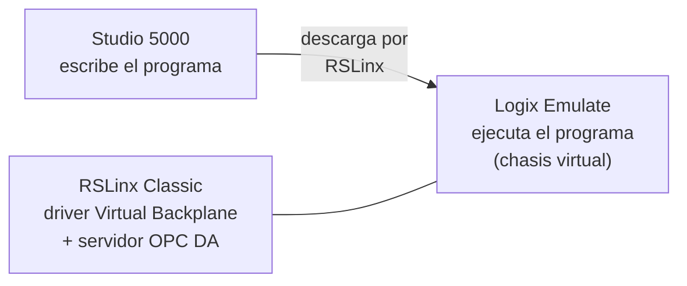

# 02 · Studio 5000, Logix Emulate y RSLinx Classic

[← Máquina virtual](01-maquina-virtual.md) · Siguiente: [OPC DA y gemelo en NX MCD →](03-opc-da-y-nx-mcd.md)

**Resultado:** el programa base de la formadora corre en un controlador emulado, en modo *Remote Run*.

Tres programas trabajan juntos y cada uno tiene un papel distinto:



## 1. Crear el controlador emulado en Logix Emulate

1. Abre **Studio 5000 Logix Emulate** (Chassis Monitor). El slot 0 ya tiene una tarjeta llamada **RSLinx**; no la borres.
2. Si la VM ya tiene un controlador *Emulate 5570* en el chasis, salta al paso 6.
3. Crea un módulo: menú **Slot → Create Module**, o clic derecho sobre un slot vacío.
4. Elige **Emulate 5570 Controller** y el número de slot.

   > [!IMPORTANT]
   > El slot del controlador emulado debe ser el mismo que espera el proyecto. Revísalo en Studio 5000 en **Controller Properties → General → Slot** (el valor habitual es 2, nunca 0 ni 1).

5. En la ventana de revisión, selecciona la que coincida con la del proyecto (en Studio 5000: **Controller Properties → General → Revision**). La guía de comunicación del laboratorio se probó con la revisión 30; el archivo base de la formadora está marcado como v32 (`RS32`). Deja el resto por defecto y termina.
6. El chasis debe mostrar **RSLinx** en el slot 0 y **Emulate 5570** en su slot.

## 2. Configurar el driver en RSLinx Classic

1. Abre **RSLinx Classic**.
2. **Communications → Configure Drivers…**
3. En *Available Driver Types* elige **Virtual Backplane (SoftLogix58xx, USB)** y pulsa **Add New…**.
4. Dale un nombre (por ejemplo `VBP-1`), deja la configuración por defecto y cierra con **OK** y **Close**.
5. Abre **RSWho** y expande el driver: debes ver el chasis virtual con RSLinx en el slot 0 y el controlador emulado en su slot.

### Tema (topic) OPC

El servidor OPC de RSLinx publica los tags a través de un **topic** que apunta a un controlador. El gemelo de la formadora lee los tags por el topic `RS_LOGIX-OPC`.

1. **DDE/OPC → Topic Configuration…**
2. Selecciona el topic `RS_LOGIX-OPC`. Si no existe, créalo con **New** y ese nombre exacto.
3. En la pestaña *Data Source*, el topic debe apuntar al controlador **Emulate 5570** dentro del driver Virtual Backplane, en su slot.
4. **Apply** y **Done**.

> [!WARNING]
> Si recreas el controlador emulado en otro slot, el topic sigue apuntando al slot viejo y el gemelo deja de recibir datos. Cada vez que cambies el slot, vuelve a revisar el topic.

## 3. Abrir el programa base y descargarlo

1. Ejecuta **Studio 5000 como administrador** (clic derecho → *Run as administrator*).
2. **Open Existing Project** → `Documentos\BOX_FORMING_CPS_CONTROL_EMULATED\BOX_FORMING_LADDER -RS32_LogixEmulate\BOX_FORMING_LADDER_RS32_logixEmulate.ACD`.
3. Reconoce lo que ya trae el proyecto:

   | Elemento | Dónde | Contenido |
   | --- | --- | --- |
   | Configuración de E/S | *I/O Configuration* | El controlador que se va a emular |
   | Ejes | *Motion Groups* | 4 ejes virtuales: banda (*conveyor*, en velocidad) y ejes X, Y, Z (en posición) |
   | Programa | *Tasks → MainTask → MainProgram* | Rutina `Main` y subrutinas (se estudian en la [Parte 1](../01-formadora-de-cajas/03-programa-base-y-grafcet.md)) |

4. **Communications → Who Active** → expande el driver Virtual Backplane → selecciona el controlador emulado → **Set Project Path**.
5. **Download** y confirma.
6. Cambia el modo a **Remote Run** (selector de modo arriba a la izquierda) y confirma.

El programa base queda corriendo. Todavía no forma cajas: las rutinas de formado y retorno son tu trabajo en la Parte 1.

## 4. Ejercicio opcional: primer contacto con Ladder

Si es la primera vez que usas Studio 5000, haz este ejercicio en un **proyecto nuevo** antes de tocar el de la formadora.

1. **New Project → Studio 5000 Logix Emulate Controller → Emulate 5570**, con la revisión y el slot del controlador emulado.
2. En **Controller Tags → Edit Tags**, crea tres tags `BOOL`: `Parada`, `Arranque` y `Motor`.
3. En `MainRoutine`, programa un arranque y parada con enclavamiento:

   ```text
   |----+--[ Arranque ]--+----[ Parada ]----------( Motor )----|
        |                |
        +--[  Motor   ]--+
   ```

   `Parada` se examina con un contacto abierto (XIC) porque en una instalación real el pulsador de parada es **normalmente cerrado**: en reposo entrega 1 y al pulsarlo entrega 0. Así, un cable cortado también detiene el motor.

4. Descarga, pasa a *Remote Run* y usa **Toggle Bit** (clic derecho sobre el tag):
   - Pon `Parada` en 1 (condición normal).
   - Pon `Arranque` en 1: `Motor` se energiza.
   - Devuelve `Arranque` a 0: `Motor` sigue en 1 por el enclavamiento.
   - Pon `Parada` en 0: `Motor` se apaga.
5. Para terminar: **Go Offline**, **File → Exit**, y cierra Logix Emulate si ya no lo necesitas.

**Siguiente:** [OPC DA y gemelo en NX MCD →](03-opc-da-y-nx-mcd.md)
