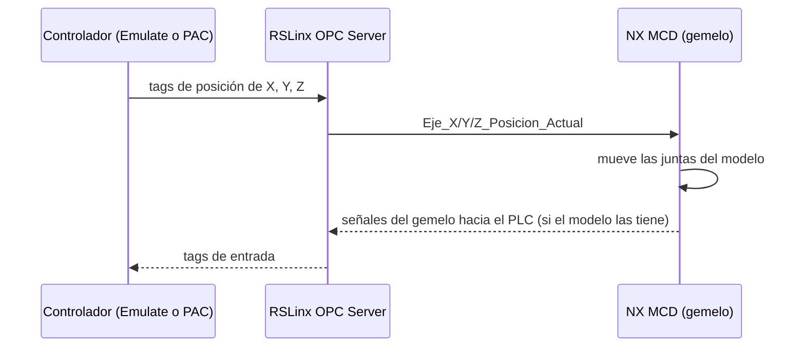

# 03 · OPC DA y gemelo digital en NX MCD

[← Studio 5000, Logix Emulate y RSLinx](02-studio5000-emulate-rslinx.md) · Siguiente: [Problemas frecuentes →](04-problemas-frecuentes.md)

**Resultado:** los tags del controlador se publican por OPC DA y el gemelo de la formadora en NX los recibe.

## Cómo se comunican

OPC (*Open Platform Communications*) es un estándar cliente–servidor para intercambiar datos entre equipos y software de automatización. Aquí **RSLinx Classic es el servidor OPC DA** que expone los tags del controlador, y **NX MCD es un cliente** que puede leerlos (posiciones de los ejes) y escribirlos (señales que nacen en el gemelo, como un sensor).



> [!NOTE]
> OPC DA no es determinista: el gemelo se actualiza con algunos milisegundos de retraso respecto al controlador. Por eso el gemelo **muestra** el movimiento, pero los lazos de control y las decisiones de la secuencia siempre se cierran dentro del controlador.

## 1. Verificar los tags con OPC Test Client

Con el programa base en *Remote Run* (guía anterior):

1. Abre **OPC Test Client** desde el menú Inicio.
2. **File → New**: en la lista de servidores elige **RSLinx OPC Server** y pulsa **OK**.
3. En el panel izquierdo, clic derecho → **Add Group**. Ponle cualquier nombre y acepta sin cambiar parámetros.
4. En el panel derecho, clic derecho → **Add Item**. En el árbol de navegación inferior expande **RS_LOGIX-OPC → Online** y agrega:
   - `Eje_X_Posicion_Actual`
   - `Eje_Y_Posicion_Actual`
   - `Eje_Z_Posicion_Actual`
5. Cada item debe mostrar un valor y calidad **Good**.

Si los tags no aparecen en el árbol, el problema está en RSLinx (driver o topic), no en NX: vuelve a la [guía 02](02-studio5000-emulate-rslinx.md#tema-topic-opc).

## 2. Verificar la licencia de NX

NX toma la licencia de un servidor de la universidad. Desde una terminal de la VM (`cmd`):

```bat
ping 168.176.36.140
```

Debe responder. Si no responde, NX no abrirá el módulo MCD. Fuera del campus puede ser necesario conectarse a la red de la universidad; confírmalo con el monitor.

## 3. Abrir el gemelo y conectar las señales

1. Abre **NX** y luego `000 - CASE ERECTOR CYBER PHYSICAL SYSTEM` (en `BOX_FORMING_DIGITAL_TWIN-NX-12_V0.5`).
2. Reconoce en el *Physics Navigator* los cuerpos, juntas, sensores, actuadores y señales ya definidos.

   > [!CAUTION]
   > No modifiques cuerpos, juntas, sensores ni actuadores del gemelo. Cualquier cambio altera la validación virtual. Solo vas a reconfigurar la conexión de señales.

3. **Signal Mapping**: en la pestaña **OPC DA**, rompe las asignaciones existentes con la función **Break**. Así se actualizan limpias en el paso 6.
4. **External Signal Configuration** → pestaña **OPC DA**: elimina el servidor que aparezca y pulsa **Add New Server**.
5. Elige **RSLinx OPC Server**, ábrelo en *Online* y selecciona las señales que el gemelo necesita: `Eje_X_Posicion_Actual`, `Eje_Y_Posicion_Actual` y `Eje_Z_Posicion_Actual`.
6. Vuelve a **Signal Mapping** y asigna cada señal de MCD a su tag del controlador. Si el modelo tiene además señales que van **de MCD hacia el PLC** (por ejemplo, la detección de la caja), asígnalas también y revisa el sentido de cada una.

## 4. Primera corrida

1. En NX, pulsa **Play** en el panel de simulación.
2. En Studio 5000, activa `START_ALL` con **Toggle Bit**.
3. La banda empieza a moverse y aparecen cajas cada cierto tiempo. El ciclo de los ejes arranca con `SENSOR_CAJA`, que en el programa base está ligado al temporizador de la rutina `NX_Signals`. Con el programa base incompleto, los ejes X, Y y Z todavía no forman la caja: eso lo programas en la Parte 1.
4. Agrega las señales al **Runtime Inspector** de NX para ver sus valores durante la simulación.

> [!TIP]
> Orden de arranque que evita la mayoría de problemas: **Logix Emulate → RSLinx → Studio 5000 (descarga y Remote Run) → OPC Test Client (verificar) → NX (Play) → `START_ALL`**. Para detener, en orden inverso.

**Siguiente:** [Problemas frecuentes →](04-problemas-frecuentes.md) · o directamente la [Parte 1 →](../01-formadora-de-cajas/README.md)
