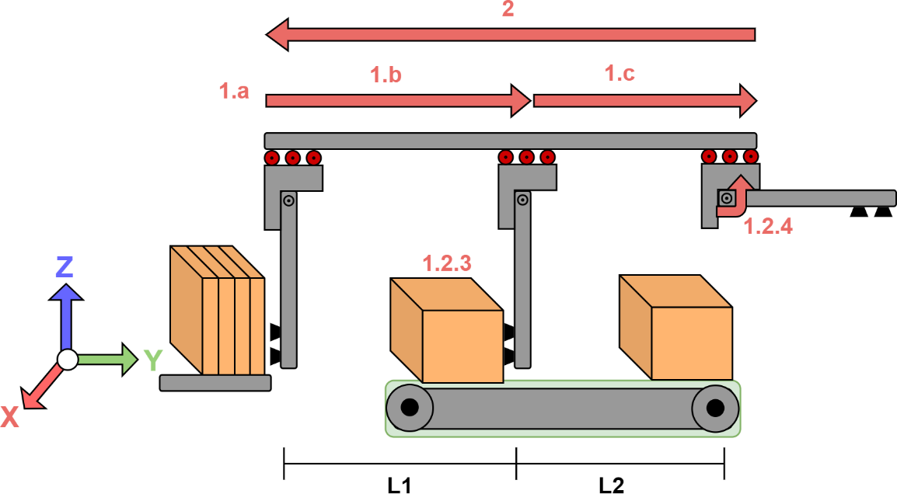
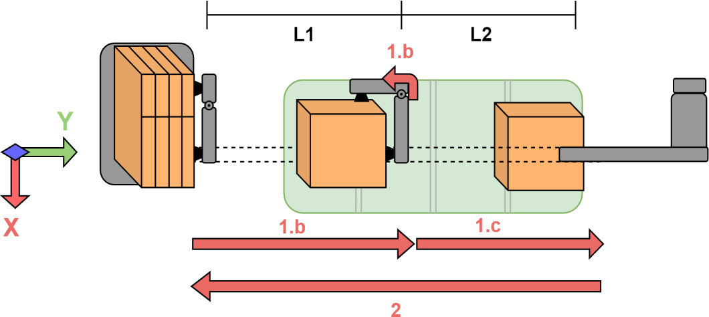

# 1 · La máquina y su ciclo

[← Parte 1](README.md) · Siguiente: [Perfiles trapezoidales →](02-perfiles-trapezoidales.md)

**Al terminar:** puedes describir, para cada etapa del ciclo, qué eje se mueve, desde dónde, hasta dónde y en cuánto tiempo.

## Ejes de la formadora

| Eje | Tipo | Qué hace | Recorrido por ciclo |
| --- | --- | --- | --- |
| **Y** | Lineal (guía sobre el pórtico) | Lleva la caja desde la pila hasta la banda y continúa hasta el final de la guía | L1 + L2 = 1,5 m + 1,5 m = **3 m** |
| **Z** (Rot_Z) | Rotación del brazo | Pliega la caja con un cuarto de vuelta mientras Y la transporta | **90°** |
| **X** (Rot_X) | Rotación del brazo | Repliega el brazo después de liberar la caja sobre la banda | **90°** |
| Banda | Velocidad | Retira las cajas formadas | Continua |

  

Vista lateral. Las flechas 1.a, 1.b y 1.c son el formado; la flecha 2 es el retorno a Home.

  

Vista superior.

## Etapas del ciclo

| Etapa | Qué ocurre | Estado inicial [Y, Rot_X, Rot_Z] | Estado final [Y, Rot_X, Rot_Z] |
| --- | --- | --- | --- |
| **1.a** Agarre | El brazo toma la caja plegada de la pila | [0, 0°, 0°] | [0, 0°, 0°] |
| **1.b** Formado | Z gira 90° y pliega la caja mientras Y la lleva hacia la banda | [0, 0°, 0°] | [L1, 0°, 90°] |
| **1.c** Liberación | La caja queda en la banda; X repliega el brazo mientras Y termina su recorrido | [L1, 0°, 90°] | [L1+L2, 90°, 90°] |
| **2** Home | Los tres ejes vuelven al origen. La primera opción es un retorno simultáneo; el equipo puede proponer otro | [L1+L2, 90°, 90°] | [0, 0°, 0°] |

Posiciones medidas desde el origen de cada eje: al final de 1.c el eje Y está en L1 + L2 = 3 m.

### Quién se mueve en cada etapa

| Eje | 1.b (t_b) | 1.c (t_c) | 2 (t_home) |
| --- | --- | --- | --- |
| Y | 0 → L1 | L1 → L1+L2 | L1+L2 → 0 |
| Z | 0° → 90° | — | 90° → 0° |
| X | — | 0° → 90° | 90° → 0° |

> [!NOTE]
> En el Grafcet del programa base, Y y Z arrancan juntos (etapa E2) y X arranca cuando Z termina (etapa E3), **mientras Y sigue moviéndose**. Es decir, el programa base trata el recorrido de Y como un solo movimiento a lo largo de 1.b y 1.c. Si prefieres dos movimientos de Y separados, es una decisión de diseño que debes justificar: piensa qué pasa con la velocidad de Y en L1.

## Del ritmo de producción al tiempo de cada etapa

El ritmo de producción RP (cajas/min) fija el tiempo unitario, es decir, el tiempo para formar una caja:

$$t_u = \frac{60}{RP}\ \text{[s]}$$

El tiempo unitario se reparte entre formado y retorno, y el formado entre sus dos etapas:

$$t_u = t_{formado} + t_{home}, \qquad t_{formado} = t_b + t_c$$

La guía de 2023 propone como punto de partida repartos iguales: $t_{formado} = t_{home} = t_u/2$ y $t_b = t_c = t_{formado}/2$. **No es obligatorio.** El retorno no transporta caja y podría ser más rápido, o solaparse con el inicio del ciclo siguiente. Esa es parte de la optimización ([guía 6](06-validacion-y-optimizacion.md)).

> [!IMPORTANT]
> Antes de calcular, abre el proyecto en Studio 5000 y revisa en cada eje **Axis Properties → Scaling → Position Units** y **→ Dynamics** (velocidad y aceleración máximas). Los recorridos de esta tabla (m, grados) deben convertirse a las unidades configuradas en cada eje, y los perfiles que calcules deben respetar esos límites.

## Para tu informe

- [ ] Tabla de etapas con los estados de los tres ejes.
- [ ] RP escogido, su justificación y el $t_u$ que resulta.
- [ ] Reparto de $t_u$ entre etapas y por qué lo elegiste.
- [ ] Unidades y límites dinámicos de cada eje, leídos del proyecto.

**Siguiente:** [Perfiles trapezoidales →](02-perfiles-trapezoidales.md)
