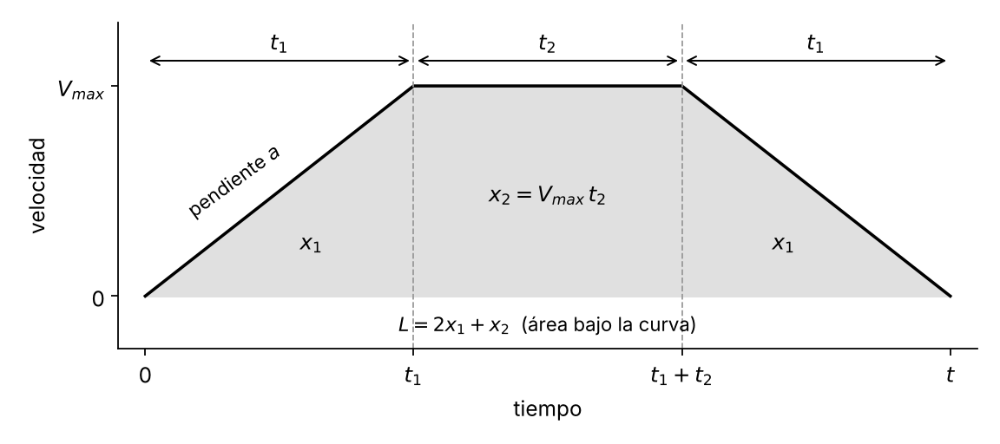

# 2 · Perfiles de velocidad trapezoidales

[← La máquina y su ciclo](01-la-maquina-y-el-ciclo.md) · Siguiente: [Programa base y Grafcet →](03-programa-base-y-grafcet.md)

**Al terminar:** para cada movimiento (eje y etapa) tienes la velocidad crucero y la aceleración que cargarás en el bloque MAM, con su justificación.

## El perfil

Un perfil trapezoidal simétrico tiene tres tramos: acelera durante $t_1$, viaja a velocidad constante $V_{max}$ durante $t_2$ y desacelera durante $t_1$. El recorrido $L$ es el área bajo la curva de velocidad.

<p align="center">
  
</p>

Variables:

| Símbolo | Significado | Unidades |
| --- | --- | --- |
| $L$ | Recorrido del movimiento (lineal para Y, angular para X y Z) | Las del eje |
| $t$ | Duración total del movimiento | s |
| $t_1$ | Tiempo de aceleración (igual al de desaceleración) | s |
| $t_2$ | Tiempo a velocidad crucero | s |
| $a$ | Aceleración (igual a la desaceleración) | unidades/s² |
| $V_{max}$ | Velocidad crucero | unidades/s |

## Relaciones

Partiendo del reposo y con simetría:

$$t = 2t_1 + t_2 \qquad V_{max} = a\,t_1 \qquad x_1 = \frac{V_{max}^2}{2a} \qquad x_2 = V_{max}\,t_2$$

El recorrido es la suma de los dos triángulos y el rectángulo:

$$L = 2x_1 + x_2 = \frac{V_{max}^2}{a} + V_{max}\left(t - \frac{2V_{max}}{a}\right) = V_{max}\,t - \frac{V_{max}^2}{a}$$

Reordenando se obtiene una ecuación de segundo grado en $V_{max}$:

$$\frac{V_{max}^2}{a} - t\,V_{max} + L = 0$$

> [!NOTE]
> La guía de 2023 (ecuación 12) escribe el primer término como $(V_{max}/a)^2$. Lo correcto es $V_{max}^2/a$; las ecuaciones 13 a 16 de esa guía sí son correctas.

## Tres formas de fijar el perfil

Con $L$ y $t$ dados por la geometría y el ritmo, falta **una** decisión de diseño. Cualquiera de estas tres es válida; justifica la que elijas.

**A. Fijar la aceleración $a$** (por ejemplo, un límite del eje). Se toma la raíz menor, que es la que tiene tramo de velocidad constante:

$$V_{max} = \frac{a}{2}\left(t - \sqrt{t^2 - \frac{4L}{a}}\right), \qquad \text{con } a \ge \frac{4L}{t^2}$$

Si $a < 4L/t^2$, ningún perfil recorre $L$ en el tiempo $t$: hay que aceptar más aceleración o más tiempo.

**B. Fijar el tiempo de rampa $t_1$** (o la fracción $t_1/t$):

$$a = \frac{L}{t_1\,(t - t_1)}, \qquad V_{max} = a\,t_1 = \frac{L}{t - t_1}, \qquad 0 < t_1 \le \frac{t}{2}$$

**C. Fijar la velocidad crucero $V_{max}$** (por ejemplo, la máxima del eje):

$$t_1 = t - \frac{L}{V_{max}}, \qquad a = \frac{V_{max}}{t_1}, \qquad \frac{L}{t} < V_{max} \le \frac{2L}{t}$$

### Dos casos límite que conviene reconocer

| Caso | Condición | Resultado |
| --- | --- | --- |
| Triangular | $t_1 = t/2$, $a = 4L/t^2$ | $V_{max} = 2L/t$; mínima aceleración posible, sin tramo constante |
| 1/3 – 1/3 – 1/3 | $t_1 = t/3$ | $V_{max} = 1{,}5\,L/t$, $a = 4{,}5\,L/t^2$ |

El perfil 1/3 es un buen punto de partida para cargas inerciales. Con $a = L/(t_1(t-t_1))$, tanto la aceleración RMS como la potencia pico $a\,V_{max}$ son proporcionales a $1/\big(t_1(t-t_1)^2\big)$, y esa expresión es mínima en $t_1 = t/3$.

## Ejemplo de cálculo

Un movimiento genérico (no es un eje de la formadora) de $L = 1{,}5$ m en $t = 1{,}25$ s con perfil 1/3:

- $t_1 = t/3 = 0{,}4167$ s y $t_2 = 0{,}4167$ s
- $V_{max} = 1{,}5 \cdot 1{,}5 / 1{,}25 = 1{,}8$ m/s
- $a = 4{,}5 \cdot 1{,}5 / 1{,}25^2 = 4{,}32$ m/s² (mayor que el mínimo $4L/t^2 = 3{,}84$ m/s²)
- Comprobación: $V_{max}(t - t_1) = 1{,}8 \cdot 0{,}8333 = 1{,}5$ m ✓

Verificación con la herramienta del repositorio:

```bash
python herramientas/perfil_trapezoidal.py --L 1.5 --t 1.25 --frac 0.3333 --plot perfil.png
```

## Tabla de parámetros que debes construir

Una fila por cada movimiento que programarás. Usa las **unidades configuradas en cada eje**.

| Etapa | Eje | Tipo | Posición destino | $L$ | $t$ | Criterio ($a$, $t_1$ o $V_{max}$) | $V_{max}$ → Speed | $a$ → Accel y Decel |
| --- | --- | --- | --- | --- | --- | --- | --- | --- |
| 1.b | Z | Absoluto | | | | | | |
| 1.b–1.c | Y | Absoluto | | | | | | |
| 1.c | X | Absoluto | | | | | | |
| 2 | Y | Absoluto | | | | | | |
| 2 | Z | Absoluto | | | | | | |
| 2 | X | Absoluto | | | | | | |

Antes de pasar a Ladder, revisa cada fila:

- [ ] $a \ge 4L/t^2$ (el perfil existe).
- [ ] $V_{max}$ y $a$ están por debajo de los límites del eje (*Axis Properties → Dynamics*).
- [ ] La suma de tiempos de las etapas es igual al $t_u$ que escogiste.
- [ ] Si Y hace un solo movimiento en 1.b y 1.c, Z termina su giro cuando Y llega a $L_1$. Con un perfil simétrico de Y y $L_1 = L_2$, Y pasa por $L_1$ justo en la mitad de su tiempo de movimiento.

> [!TIP]
> En el MAM, `Speed` y `Accel/Decel Rate` van en *Units per sec* y *Units per sec²* (las unidades del eje). Los operandos de *jerk* solo se usan con perfil **S-curve**; con perfil trapezoidal se ignoran, aunque el bloque exige llenarlos.

**Siguiente:** [Programa base y Grafcet →](03-programa-base-y-grafcet.md)
