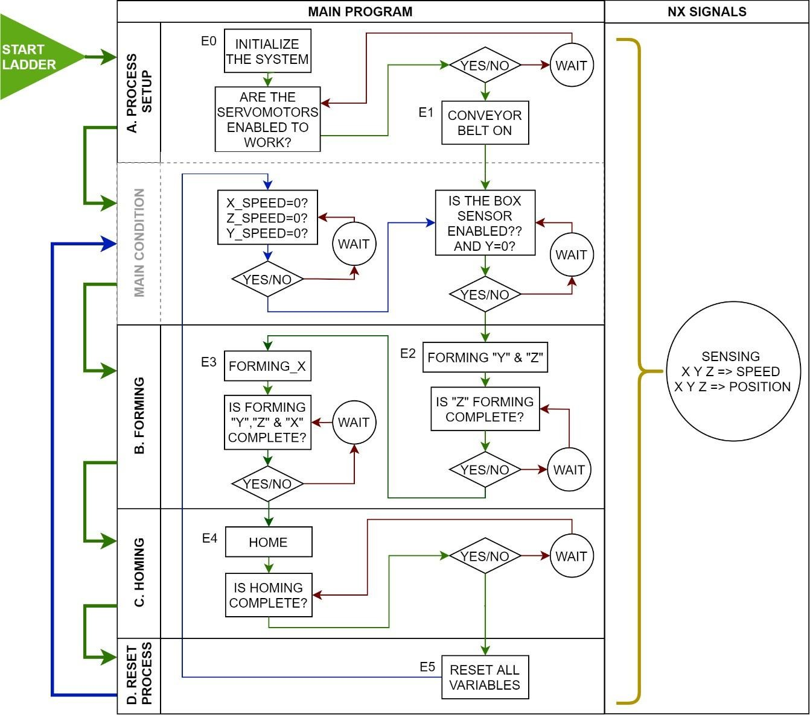
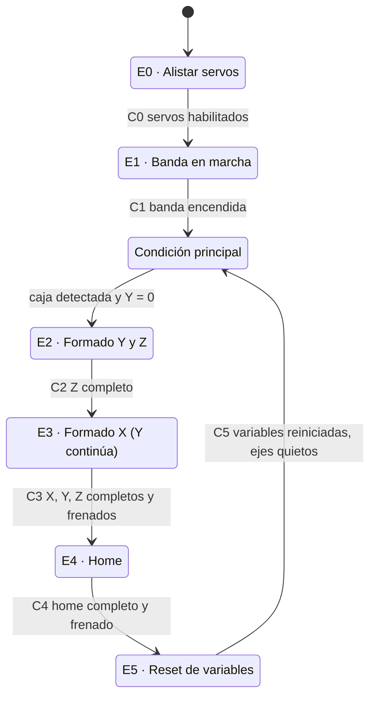

# 3 · Programa base y Grafcet

[← Perfiles trapezoidales](02-perfiles-trapezoidales.md) · Siguiente: [Completar Formado y Home →](04-completar-formado-y-home.md)

**Al terminar:** puedes explicar qué hace cada rutina del programa base, cómo se entra y se sale de cada etapa, y dónde va tu código.

## Grafcet de la máquina

El programa está escrito en Ladder, pero organizado como un Grafcet: **etapas** (estados en los que se ejecutan acciones) y **transiciones** (condiciones que habilitan la etapa siguiente). Cada bloque del diagrama corresponde a una rutina de `MainProgram`.

  

Flechas verdes: secuencia normal. Rojas: esperas hasta que una tarea termina. Azul: lazo principal que reinicia el ciclo. Fuente: Guía de Box Forming, 2023.

La misma secuencia, en forma de máquina de estados:

## Rutinas

| Rutina | Etapas | Qué hace | ¿La modificas? |
| --- | --- | --- | --- |
| `Main` | — | Llama las subrutinas. En su **rung 4** está la condición principal: C1 habilita el primer ciclo y C5 los siguientes | No |
| Process Setup | E0, E1 | Parada de emergencia, reinicio de motores, alistamiento de los servos (E0) y arranque de la banda (E1) | No |
| **`B_Process_Formado`** | E2, E3 | E2 mueve Y y Z; cuando Z termina (C2), E3 mueve X mientras Y sigue. Al terminar los tres ejes se ejecuta el frenado (MAS) y se cumple C3 | **Sí: la programas tú** |
| **`C_Process_Home`** | E4 | Lleva los tres ejes al origen; al terminar y frenar se cumple C4 | **Sí: completas instrucciones y parámetros** |
| Process Reset | E5 | Reinicia las variables del ciclo con bobinas de desenclavamiento (*unlatch*) y atiende `STOP_ALL`. Al terminar se cumple C5 | No |
| `NX_Signals` | Paralela | Corre siempre. Copia el estado de los ejes a tags propios para OPC (`Eje_X_Posicion_Actual`, etc.) y genera la aparición de cajas con un temporizador en el **rung 4** | Solo el preset del temporizador |

### Por qué el gemelo no lee directamente los ejes

`NX_Signals` copia posiciones y velocidades a tags intermedios y el gemelo solo ve esos tags. Así, la interfaz con el gemelo queda separada de la lógica de movimiento: puedes cambiar la lógica sin romper el mapeo de señales, y el gemelo nunca escribe sobre una variable de los ejes.

### Bobinas MAS como condición de cambio de etapa

`Eje_X.MAS`, `Eje_Y.MAS` y `Eje_Z.MAS` actúan como condiciones: la etapa avanza (C3 en Formado, C4 en Home) cuando los ejes terminaron su movimiento **y** completaron el frenado.

### Indexación de las instrucciones de movimiento

Cada instrucción de movimiento necesita su propio tag `MOTION_INSTRUCTION`. El programa base usa **arreglos** para que la misma instrucción pueda aparecer en varias rutinas sin compartir tag:

| Rutina | MAM del eje Y |
| --- | --- |
| `B_Process_Formado` (primer uso) | `Eje_Y.MAM[0]` |
| `C_Process_Home` (segundo uso) | `Eje_Y.MAM[1]` |
| Una rutina adicional | `Eje_Y.MAM[2]`, y así sucesivamente |

La misma regla aplica a las demás instrucciones (MAS, MAJ…). Revisa en *Data Types → User-Defined* cómo está declarada la estructura de cada eje en el programa base y qué miembros son arreglos.

> [!WARNING]
> Nunca uses el mismo tag de instrucción en dos bloques. Si dos MAM comparten `Eje_Y.MAM[0]`, sus bits de estado (`.EN`, `.IP`, `.PC`, `.ER`) se pisan y la secuencia avanza o se bloquea sin razón aparente. Si necesitas más índices de los que tiene el arreglo, amplía su dimensión en el tipo de dato.

## Antes de programar: analiza

Respondan en equipo y guarden las respuestas para el informe:

1. ¿Qué bits representan cada etapa (E0 … E5) y cada condición (C0 … C5) en el programa? Ubíquenlos en las rutinas.
2. En el rung 4 de `Main`, ¿por qué hay dos caminos (C1 y C5) para habilitar el ciclo?
3. ¿Qué pasa con las etapas activas cuando se activa `STOP_ALL`? ¿Qué rung lo garantiza?
4. ¿Cómo se asegura Process Reset de que solo una etapa esté activa a la vez?
5. ¿Qué tags escribe `NX_Signals` y cuáles lee el gemelo?
6. ¿Qué eje se controla en velocidad y cuáles en posición? ¿Qué instrucción mueve cada uno?

**Siguiente:** [Completar Formado y Home →](04-completar-formado-y-home.md)
