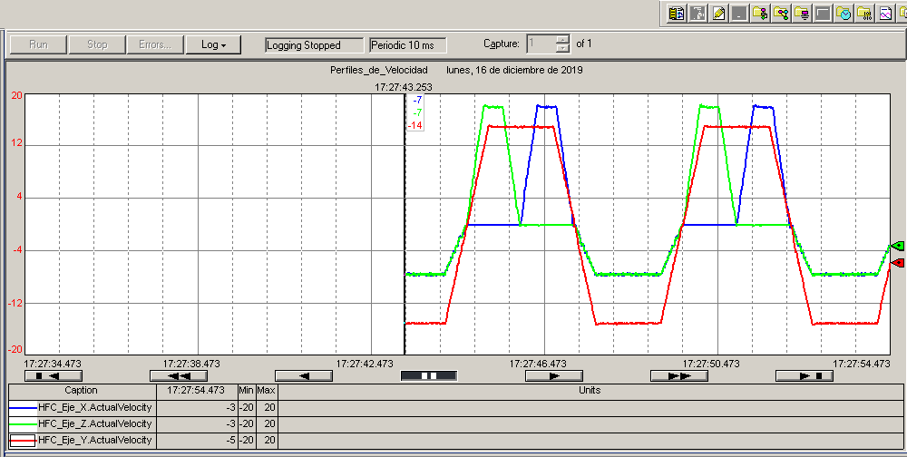

# 6 · Validación con tendencias y optimización

[← Corrida con el gemelo](05-corrida-con-el-gemelo.md) · [Volver a la Parte 1](README.md)

**Al terminar:** tienes la evidencia de que tu rutina cumple el ritmo de producción (tendencias, tiempos medidos y comparación con el cálculo) y una propuesta de mejora justificada.

## 1. Tendencias (Trends) en Studio 5000

El proyecto base trae una tendencia preconfigurada. Ábrela desde el árbol del controlador (*Trends*) y pulsa **Run** mientras corre el ciclo.

  

Ejemplo de tendencia de velocidad real de X, Y y Z: primero Y+Z, luego Y+X y al final el retorno simultáneo. La validación de cada equipo depende de su propia parametrización. Fuente: Guía de Box Forming, 2023.

Configura la tendencia para que muestre al menos:

| Señal | Para qué |
| --- | --- |
| `ActualVelocity` de X, Y y Z | Forma de los perfiles: rampas, mesetas y simultaneidad |
| `ActualPosition` de X, Y y Z | Posiciones alcanzadas en cada etapa |
| Tag de etapa (o los bits E2 … E5) | Relacionar cada tramo de la curva con la etapa del Grafcet |

> [!TIP]
> Un periodo de muestreo de 10 ms es suficiente para ver los perfiles. Exporta los datos a CSV para medir tiempos con precisión fuera de Studio 5000.

## 2. Qué medir

Completa esta tabla con tus valores calculados y los medidos en la tendencia:

| Movimiento | $t$ calculado [s] | $t$ medido [s] | $V_{max}$ calculada | $V_{max}$ medida | Diferencia |
| --- | --- | --- | --- | --- | --- |
| Z en 1.b | | | | | |
| Y en 1.b–1.c | | | | | |
| X en 1.c | | | | | |
| Home (el más lento) | | | | | |
| **Ciclo completo** | $t_u$ = | | — | — | |

Y el resultado global:

$$RP_{real} = \frac{60}{t_{ciclo,\ medido}}\ \text{cajas/min}$$

Explica las diferencias entre lo calculado y lo medido. Fuentes típicas: el tiempo de frenado de las MAS, el retardo entre una etapa y la siguiente (escaneo del programa), la comunicación con el gemelo y el margen del temporizador.

## 3. Optimización

La guía de 2023 lo plantea así: **la variable a optimizar no es la velocidad de los ejes, sino los tiempos de las subrutinas y la relación entre ellas**. Algunas preguntas para orientar la propuesta:

- ¿Necesita el retorno durar lo mismo que el formado? El brazo vuelve sin caja.
- ¿Puede empezar el retorno de X o de Z antes de que Y termine su recorrido?
- ¿Qué tiempo se pierde entre etapas (frenado con MAS, confirmaciones)? ¿Es necesario en todos los casos?
- ¿Qué cambia si usas perfil *S-curve* en lugar de trapezoidal? Compara la tendencia de aceleración.
- ¿Cuál es el eje que limita el ritmo, y por qué? ¿Velocidad máxima, aceleración o recorrido?

La propuesta va en el informe con su **Grafcet**, los cálculos, la tendencia que la valida y el nuevo RP medido.

## 4. Checklist de entrega de la Parte 1

- [ ] Ritmo de producción escogido y justificado.
- [ ] Tabla de perfiles: cálculo a mano de cada movimiento y verificación.
- [ ] Grafcet de la solución y explicación de cada rung de `B_Process_Formado` y `C_Process_Home`.
- [ ] Capturas de las tendencias del ciclo completo, con las etapas identificadas.
- [ ] Tabla calculado vs. medido y $RP_{real}$.
- [ ] Video corto del gemelo formando cajas de forma continua (recomendado para la sustentación).
- [ ] Programa `.ACD` y exportación `.L5X` de las rutinas modificadas.

Detalle de los entregables: [entregables y evaluación](../entregables-y-evaluacion.md).

**Siguiente paso del proyecto:** [Parte 2 · Etiquetadora de cajas →](../02-etiquetadora-de-cajas/README.md)
