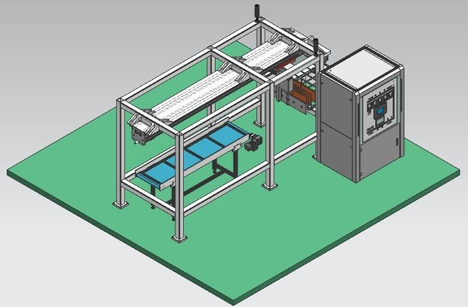

# Parte 1 · Formadora de cajas con gemelo digital

[← Proyecto Integrador Industrial](../README.md)

  

Gemelo digital de la formadora de cajas (<i>case erector</i>) en Siemens NX MCD.

## El problema

Una planta de manufactura en Colombia despacha sus productos en cajas de cartón reciclado que llegan plegadas y apiladas. Hoy un operario las arma a mano: es lento, repetitivo y afecta su salud. La planta compra una **formadora de cajas de tres ejes coordinados (X, Y, Z) con banda transportadora** y les pide a ustedes, el equipo de ingeniería mecatrónica, que la programen para producir al **mayor ritmo posible sin perder la coordinación entre ejes**.

El ritmo de producción (RP) lo escoge y justifica cada equipo. El enunciado 2026-2S indica que lo habitual es 5 < RP < 10 y que **se espera 10 ≤ RP ≤ 20 cajas/minuto**.

## Lo que recibes y lo que haces

| Recibes | Haces |
| --- | --- |
| Gemelo digital en NX MCD con cuerpos, juntas, sensores y señales definidos | Conectarlo por OPC DA al controlador emulado |
| Programa Ladder base con configuración, ejes y las rutinas `Main`, Process Setup, Process Reset y `NX_Signals` | Entender su Grafcet y completar **`B_Process_Formado`** y **`C_Process_Home`** |
| Geometría de la máquina (recorridos de los ejes) | Calcular los perfiles trapezoidales de cada eje en cada etapa |
| Tendencias (Trends) preconfiguradas en Studio 5000 | Validar el ciclo completo y medir el ritmo real |

## Objetivos

Al terminar podrás:

1. Calcular y justificar perfiles de movimiento trapezoidales a partir de un ritmo de producción.
2. Leer un programa Ladder estructurado como Grafcet y completar sus etapas con instrucciones MAM y MAS.
3. Enlazar el controlador con el gemelo digital por OPC DA y operar el sistema ciberfísico completo.
4. Validar el movimiento con tendencias y proponer mejoras a la secuencia.

## Guías

| # | Guía | Pregunta que responde |
| --- | --- | --- |
| 1 | [La máquina y su ciclo](01-la-maquina-y-el-ciclo.md) | ¿Qué hace cada eje en cada etapa? |
| 2 | [Perfiles trapezoidales](02-perfiles-trapezoidales.md) | ¿Qué velocidad y aceleración necesita cada movimiento? |
| 3 | [Programa base y Grafcet](03-programa-base-y-grafcet.md) | ¿Cómo está organizado el programa que recibo? |
| 4 | [Completar Formado y Home](04-completar-formado-y-home.md) | ¿Qué rungs y parámetros debo programar? |
| 5 | [Corrida con el gemelo](05-corrida-con-el-gemelo.md) | ¿Cómo pongo a funcionar el sistema ciberfísico? |
| 6 | [Validación y optimización](06-validacion-y-optimizacion.md) | ¿Cumple el ritmo? ¿Cómo lo mejoro? |

Herramienta: [`herramientas/perfil_trapezoidal.py`](herramientas/perfil_trapezoidal.py), para **verificar** los cálculos hechos a mano.

## Antes de empezar

- [ ] Terminaste la [instalación](../00-instalacion/README.md) y pasa la prueba de humo.
- [ ] Tienes a mano el manual *Logix 5000 Controllers Motion Instructions* (MOTION-RM002), capítulo 3: MAS, MAH, MAJ y MAM.
- [ ] El equipo acordó roles: cálculo de perfiles, programación, integración con el gemelo y documentación.
