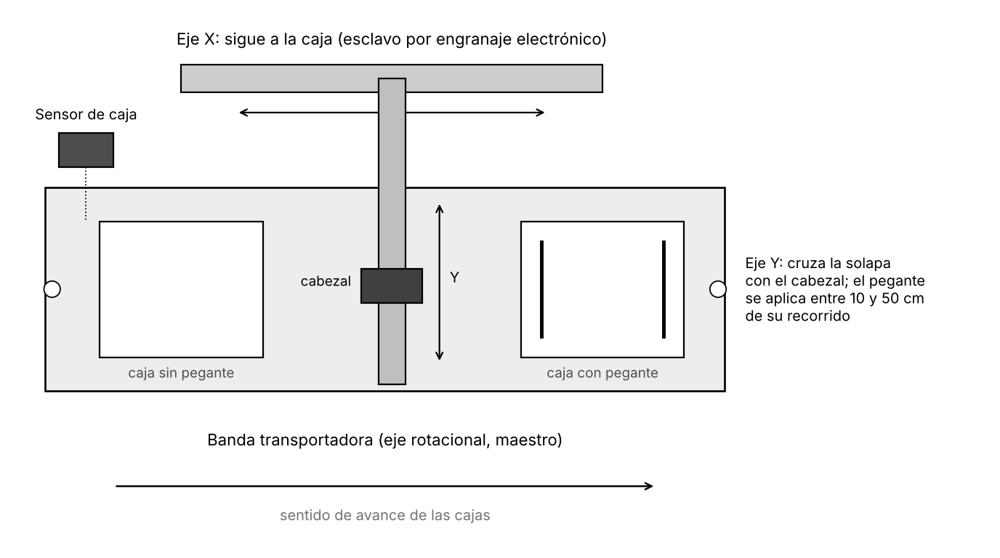

# 02 · La máquina y la estación del laboratorio

[← Seguridad](01-seguridad-y-reglas.md) · Siguiente: [Proyecto, E/S, drives y ejes →](03-proyecto-y-hardware.md)

**Al terminar:** conoces el ciclo de la etiquetadora, el hardware de la estación, el mapa de entradas y salidas y los parámetros mecánicos que debes definir antes de programar.

## La máquina

  

Esquema conceptual en vista superior, no a escala.

| Eje | Función | Tipo de movimiento | Instrucción principal |
| --- | --- | --- | --- |
| **Rotacional** (banda) | Mueve la banda y las cajas | Velocidad constante, sin límite de recorrido | MAJ |
| **X** | Lleva el cabezal a la misma velocidad que la caja | Engranaje electrónico con la banda (esclavo) | MAG |
| **Y** | Lleva el cabezal a través de la solapa | Posición, recorrido limitado | MAM |

### Ciclo

1. Los servos se habilitan y los ejes van a su posición inicial.
2. La banda arranca a velocidad constante.
3. El sensor detecta una caja → X se engrana a la banda y Y inicia su recorrido.
4. Mientras Y está entre **10 y 50 cm**, se activa la salida `Aplicar_Pegante`.
5. Al llegar Y a **55 cm**, se detienen el engranaje de X y el movimiento de Y.
6. X e Y regresan a 0 y la máquina espera la siguiente caja; la banda sigue andando.

Valores de referencia de las guías de 2015: recorrido útil de Y = 60 cm (límites de 0 a 60 cm), desplazamiento de Y = 55 cm, ventana de pegante = 10 a 50 cm.

## Hardware de la estación

| Elemento | Referencia | Notas |
| --- | --- | --- |
| PAC | CompactLogix 5370 L3, **1769-L30ERM** | Dos puertos EtherNet/IP; control de movimiento integrado |
| Entradas digitales | **1769-IQ16**, slot 4 | Etiqueta azul. Los slots se cuentan de izquierda a derecha sin contar la fuente; confirma en sitio levantando la tapa del módulo |
| Salidas digitales | **1769-OW8**, slot 5 | Etiqueta naranja |
| Drives | 3 × Kinetix 350 **2097-V31PR2-LM** | Un eje por drive. El display del drive muestra su IP desplazándose, o un código de falla |
| Servomotores | 3 × **MPL-A230P-HJ72AA** | Serie MP de baja inercia, 230 V, velocidad nominal 5000 rpm, encoder incremental de 2000 líneas |
| Cables | Potencia (naranja) y realimentación (negro, conector DB9 en el drive) | No desconectar con el drive energizado |
| Botonera | Pulsadores y testigos cableados a los módulos de E/S | Mapa abajo |

### Mapa de entradas y salidas

Asignación de la guía 6 de 2015. **Verifica el cableado real de tu estación** antes de usarlo.

| Tag | Dirección | Tipo | Función |
| --- | --- | --- | --- |
| `Servo_On` | `Local:4:I.Data.0` | Entrada | Habilitar servos (MSO) |
| `Inicio_Operacion` | `Local:4:I.Data.1` | Entrada | Iniciar la rutina |
| `Parada_Emergencia` | `Local:4:I.Data.2` | Entrada | Parada por programa del grupo (MGS / MGSD) |
| `Servo_Off` | `Local:4:I.Data.3` | Entrada | Deshabilitar servos (MAS / MSF) |
| `Sensor_Caja` | `Local:4:I.Data.4` | Entrada | Detección de caja (sensor réflex) |
| `Testigo` | `Local:5:O.Data.0` | Salida | Servos habilitados |
| `Testigo_Parada` | `Local:5:O.Data.1` | Salida | Servos deshabilitados o parada activa |
| `Aplicar_Pegante` | `Local:5:O.Data.2` | Salida | Ventana de aplicación de pegante |

> [!TIP]
> Declara estos tags como **alias** de las direcciones físicas. En el modo A (emulado) no hay módulos de E/S: ahí los mismos nombres pueden ser tags `BOOL` internos o alias de bits de un tag de simulación. La lógica no cambia entre modos; solo cambia a qué apunta cada alias.

### Red

| Equipo | Dirección |
| --- | --- |
| PAC de tu equipo | Rotulada en el tablero (por ejemplo, *PAC 4 – IP 10.203.3.249*) |
| Drives Kinetix 350 | 10.203.3.241, .242 y .243 en las guías de 2015; confirma en el display de cada drive |
| Driver de comunicaciones en los PC del laboratorio | `ETHIP-1` (EtherNet/IP) en la guía de 2023 |

## Parámetros mecánicos que debes definir

En el laboratorio los motores giran sin mecanismo acoplado. **La mecánica la pone el gemelo**, y el escalado de cada eje en Studio 5000 debe ser el mismo que usa el gemelo. Defínanlos con el monitor y regístrenlos aquí, porque de ellos dependen el escalado, la relación de engranaje y la carrera de X:

| Parámetro | Símbolo | Valor | Unidad |
| --- | --- | --- | --- |
| Diámetro del rodillo motriz de la banda | $D_b$ | | mm |
| Transmisión del eje X (tornillo de paso $p_x$ o polea de diámetro $D_x$) | | | mm |
| Transmisión del eje Y (tornillo de paso $p_y$ o polea de diámetro $D_y$) | | | mm |
| Relación de reducción de cada eje, si hay | $i$ | | — |
| Carrera útil de X | | | cm |
| Carrera útil de Y | | 60 | cm |
| Velocidad de la banda en operación | $v_b$ | | cm/s |

Con esto, en la [guía 04](04-puesta-en-marcha-de-ejes.md) calcularás cuántos cm avanza cada eje por revolución del motor.

## Para pensar antes de seguir

1. Si la banda va a $v_b$ y Y tarda $t_Y$ en recorrer 55 cm, ¿qué carrera mínima necesita el eje X para seguir a la caja todo ese tiempo?
2. Si la banda y X están escalados ambos en cm de recorrido lineal, ¿qué relación de engranaje hace que el cabezal viaje exactamente a la velocidad de la caja?

**Siguiente:** [Proyecto, E/S, drives y ejes →](03-proyecto-y-hardware.md)
