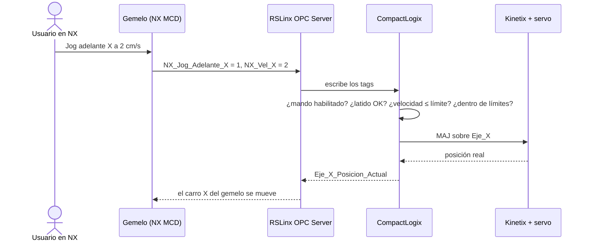

# 07 · Gemelo digital conectado al PAC físico

[← Movimientos básicos](06-movimientos-basicos.md) · Siguiente: [Secuencia coordinada →](08-secuencia-coordinada.md)

**Al terminar:** el gemelo de la etiquetadora muestra en tiempo real lo que hacen los tres servos del laboratorio, y una orden de movimiento dada desde el gemelo, a la velocidad que elijas, mueve el servo real.

## La idea: dos sentidos, una sola autoridad

| Sentido | Qué pasa | Nombre |
| --- | --- | --- |
| PAC → gemelo | El PAC publica la posición real de cada eje; las juntas del gemelo la siguen | **Espejo** |
| Gemelo → PAC → servo | El gemelo envía una **solicitud** (jog adelante o atrás, con velocidad); el PAC la valida y ejecuta un MAJ; el servo se mueve; su posición real vuelve al gemelo | **Mando** |

**El PAC es la única autoridad sobre los motores.** El gemelo nunca escribe una consigna de posición ni de velocidad directamente en un eje; solo escribe solicitudes que la lógica puede rechazar. Y el carro que ves moverse en el gemelo está movido por la posición **real** del servo, no por la solicitud: si el servo no se mueve, el gemelo tampoco.

> [!WARNING]
> OPC DA no es determinista y tiene retardos de decenas de milisegundos o más. Sirve para ver y para pedir, nunca para cerrar un lazo de control. Los lazos de posición, velocidad y corriente siguen dentro del PAC y del drive.

## 1. El modelo del gemelo

El modelo base en NX MCD lo entrega el curso. Contiene, como mínimo:

| Elemento MCD | Para qué | Señal |
| --- | --- | --- |
| Superficie de transporte sobre la banda, con control de velocidad | Mover las cajas a la velocidad real de la banda | `Banda_Velocidad` |
| Junta deslizante del carro X, con control de posición | Seguir la posición real del eje X | `X_Posicion` |
| Junta deslizante del cabezal Y, con control de posición | Seguir la posición real del eje Y | `Y_Posicion` |
| *Object Source* al inicio de la banda y *Object Sink* al final | Generar y retirar cajas | — |
| Sensor de colisión en la posición del sensor real | Detectar la caja | `Sensor_Caja` |
| Cambio de apariencia del cabezal | Ver la ventana de pegante | `Aplicar_Pegante` |
| Señales de solicitud y de eco del latido | Mando desde el gemelo | Ver el contrato |

Lista completa de señales, sentidos y unidades: [**contrato de señales**](plantillas/contrato-de-senales.csv). Los nombres del contrato son los que usa esta guía; si los cambias, cámbialos en ambos lados.

> [!NOTE]
> Revisa las unidades: el PAC trabaja en cm y cm/s (guía 04); si una junta del modelo espera mm, conviértelas en MCD (por ejemplo, con un factor en la señal) y documenta dónde lo hiciste.

## 2. Lado del PAC: rutina `Gemelo`

Crea una rutina `Gemelo` que se ejecute en cada escaneo (llamada con JSR desde `MainRoutine`, igual que `NX_Signals` en la formadora). Hace tres cosas:

### 2.1 Publicar el estado (espejo)

Copia con MOV los miembros de cada eje a los tags del contrato: `Eje_X.ActualPosition` → `Eje_X_Posicion_Actual`, etc. El gemelo lee solo esos tags, nunca los ejes directamente.

### 2.2 Vigilar la comunicación (latido)

1. Un temporizador alterna `PLC_Latido` cada 500 ms.
2. El gemelo devuelve el valor en `NX_Latido`.
3. Si `NX_Latido` es distinto de `PLC_Latido` durante más de un tiempo límite $T_{lim}$, se pone `Comunicacion_Gemelo_OK = 0`.

Cuando `Comunicacion_Gemelo_OK` cae, el PAC detiene con MAS todo movimiento que haya pedido el gemelo y deja de aceptar solicitudes. $T_{lim}$ debe ser mayor que el retardo de ida y vuelta que **midas** (sección 4); empieza con 2 s.

### 2.3 Aceptar solicitudes (mando)

| Condición para aceptar un jog pedido por el gemelo | Por qué |
| --- | --- |
| `Mando_Remoto_Habilitado` = 1 | Lo activa quien opera la estación, nunca el gemelo |
| `Comunicacion_Gemelo_OK` = 1 | El gemelo está vivo |
| Secuencia automática detenida | Mando manual y automático son excluyentes |
| Servo del eje habilitado y sin falla | |
| Solicitud adelante **xor** atrás | Nunca las dos a la vez |

Si se cumplen, el PAC limita la velocidad pedida a un máximo seguro `V_Lim_Gemelo` (compara con GRT/LES y usa MOV, o la instrucción LIM) y ejecuta el MAJ del eje con `Mov_X.MAJ[1]`. Al caer la solicitud ejecuta MAS tipo *Jog*. Los *soft limits* del eje siguen activos todo el tiempo.

`Mando_Gemelo_Activo` informa al gemelo si el PAC está aceptando órdenes.

## 3. Conexión OPC al PAC físico

En la Parte 1 RSLinx hablaba con un controlador emulado por el *Virtual Backplane*. Ahora habla con el PAC por Ethernet.

En **modo A** (en casa, con Logix Emulate y ejes virtuales) no cambia nada respecto a la Parte 1: crea el topic apuntando al controlador emulado y conecta el gemelo igual. Así puedes probar la rutina `Gemelo` antes de ir al laboratorio.

### Dónde corre RSLinx y NX

| Opción | Cuándo usarla |
| --- | --- |
| Un computador del laboratorio con RSLinx Classic y NX | Si están instalados; es lo más directo |
| Tu VM, conectada a la red del laboratorio | Si el computador del laboratorio no tiene NX. Para OPC no importa la versión de Studio 5000 de la VM: solo se leen y escriben tags |

Si usas la VM: en *Edit virtual machine settings → Network Adapter* elige **Bridged** y pide al laboratorista una IP libre del segmento 10.203.3.x. Confirma con `ping` a la IP de tu PAC.

### Configurar RSLinx Classic

1. **Communications → Configure Drivers → Ethernet devices → Add New**. Escribe la IP de tu PAC en la lista de estaciones.
2. En **RSWho** debe aparecer el PAC y, dentro de él, el controlador 1769-L30ERM.
3. **DDE/OPC → Topic Configuration → New**: nombre `ETIQUETADORA`. En *Data Source*, navega hasta el controlador del PAC y pulsa **Apply**. En *Data Collection* revisa el periodo de actualización; decenas de milisegundos son suficientes para visualizar.
4. Verifica con **OPC Test Client** los tags `Eje_X_Posicion_Actual` y `PLC_Latido` bajo el topic `ETIQUETADORA` (calidad *Good*).

### Conectar el gemelo

En NX, igual que en la [guía de instalación 03](../00-instalacion/03-opc-da-y-nx-mcd.md#3-abrir-el-gemelo-y-conectar-las-señales): **External Signal Configuration → OPC DA → RSLinx OPC Server**, selecciona los tags del topic `ETIQUETADORA` y asígnalos en **Signal Mapping** según el contrato. Revisa el sentido de cada señal.

## 4. Pruebas, en este orden

| # | Modo | Prueba | Criterio de éxito |
| --- | --- | --- | --- |
| 1 | B | MAM de `Eje_Y` (virtual) a 10 cm desde Studio 5000 | El cabezal del gemelo llega a 10 cm |
| 2 | B | Medir el retardo de ida y vuelta: tiempo entre el cambio de `PLC_Latido` y el de `NX_Latido` | Valor medido y registrado; con él se fija $T_{lim}$ |
| 3 | B | Detener la simulación de NX con un jog pedido por el gemelo en curso | El PAC detiene el eje antes de $T_{lim}$ + tiempo de frenado |
| 4 | C | Jog positivo, lento y corto de cada eje desde Studio 5000 | Servo y gemelo se mueven en el mismo sentido (si no, revisa la polaridad, guía 04) |
| 5 | C | Desde el gemelo: `NX_Vel_X` = 2 cm/s y jog adelante X | El servo real gira; el carro del gemelo avanza ~2 cm/s; al soltar, ambos se detienen |
| 6 | C | Desde el gemelo: velocidad por encima de `V_Lim_Gemelo` | El PAC limita la velocidad al máximo seguro |
| 7 | C | Pulsar la parada de la botonera durante un jog pedido por el gemelo | Parada inmediata del grupo |

Para medir el retardo de la prueba 2, agrega `PLC_Latido` y `NX_Latido` a una tendencia y mide el desfase entre sus flancos.

## Evidencia

- [ ] Tabla de señales mapeadas en NX con su sentido y unidades.
- [ ] Captura de la rutina `Gemelo` (espejo, latido y mando).
- [ ] Retardo de ida y vuelta medido y $T_{lim}$ elegido.
- [ ] Video corto de las pruebas 5 y 3: servo real y gemelo a la vez, y parada por pérdida de comunicación.

**Siguiente:** [Secuencia coordinada →](08-secuencia-coordinada.md)
