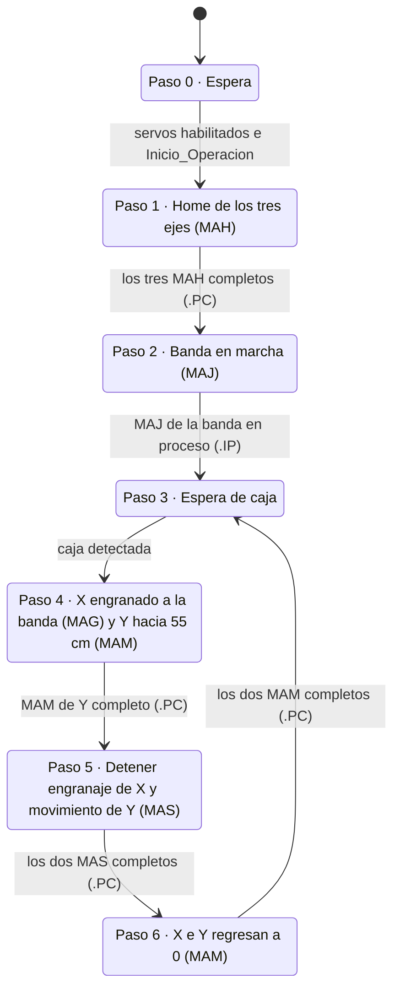

# 08 · Secuencia coordinada de la etiquetadora

[← Gemelo digital conectado al PAC](07-gemelo-conectado-al-pac.md) · [Volver a la Parte 2](README.md)

**Al terminar:** la etiquetadora completa funciona en ciclo continuo con los tres servos reales y su gemelo: la banda avanza, X sigue a cada caja, Y cruza la solapa y el pegante se aplica solo en su ventana.

*Basada en la guía de programación de movimiento III de 2015.* Desarrolla en modo A, prueba en B y valida en C.

## 1. Grafcet de la secuencia



Durante el paso 4, una acción continua calcula la salida de pegante:

$$\texttt{Aplicar\_Pegante} = (y \ge 10\ \text{cm}) \wedge (y \le 50\ \text{cm})$$

donde $y$ es la posición real de `Eje_Y` (comparaciones GEQ y LEQ sobre `Eje_Y.ActualPosition`).

**Caja detectada** = `Sensor_Caja` (sensor réflex real) **o** `NX_Sensor_Caja` (sensor del gemelo). En el laboratorio no hay cajas físicas: el sensor del gemelo es el que dispara el ciclo, y el réflex sirve para disparos manuales.

## 2. Implementación por pasos en Ladder

Una variable `Paso` (DINT) indica la etapa activa. Cada rung empieza con una comparación y termina, cuando se cumple la transición, con un MOV al paso siguiente:

```text
|--[EQU Paso 4]------+--[MAM Eje_Y ... Mov_Y.MAM[0]]-------------------------|
|                    |                                                       |
|                    +--[XIC Mov_Y.MAM[0].PC]----[MOV 5 Paso]----------------|
```

| Instrucción | Uso aquí |
| --- | --- |
| EQU | ¿Estoy en el paso *n*? |
| MOV | Pasar al paso siguiente (y fijar parámetros calculados) |
| GEQ / LEQ | Ventana de pegante sobre la posición de Y |
| `.IP` / `.PC` | Transiciones: instrucción en proceso / proceso completo |

Usa índices distintos de las instrucciones que se repiten: por ejemplo, `Mov_Y.MAM[0]` hacia 55 cm y `Mov_Y.MAM[1]` de regreso a 0; `Mov_X.MAS[1]` para detener el engranaje y `Mov_Y.MAS[1]` para detener el movimiento.

Como ejercicio de transferencia, escribe también el secuenciador en **texto estructurado** (`CASE Paso OF …`) o como **SFC**. Los tres lenguajes son de la IEC 61131-3 y la lógica es la misma.

## 3. Cálculos de diseño

### 3.1 Relación de engranaje

Para que el cabezal viaje a la velocidad de la caja, la velocidad lineal de X debe ser igual a la de la banda. Con *Ratio Format* = *Real*, la relación es unidades del esclavo por unidad del maestro:

$$R = \frac{s_{banda}}{s_X}$$

donde $s$ es cuántos cm de recorrido lineal representa una unidad de posición de cada eje. Si la banda y X están ambos escalados en cm de recorrido lineal, **$R = 1$**.

> [!NOTE]
> **Corrección a la guía de 2015.** La guía 6 usaba una relación de **2** "para que la pistola se desplace a la misma velocidad de la caja". Con los dos ejes escalados en las mismas unidades lineales, $R = 2$ hace que el cabezal avance al **doble** de la velocidad de la caja. Con el gemelo conectado esto se ve de inmediato: el cabezal se adelanta a la caja.

### 3.2 Desfase por el embrague

Con *Clutch* habilitado, X arranca desde el reposo y acelera con $a_c$ hasta la velocidad de la banda $v_b$. Mientras tanto, la caja ya va a $v_b$, así que el cabezal queda atrás una distancia:

$$\Delta x = \frac{v_b^2}{2\,a_c}$$

¿Cómo lo compensas? Por ejemplo, ubicando la posición inicial de X adelantada en $\Delta x$, o retrasando el arranque de Y hasta que termine el embrague. Justifica tu elección.

### 3.3 Carrera necesaria de X

Si Y tarda $t_Y$ en ir de 0 a 55 cm (con la [ecuación del perfil trapezoidal de la Parte 1](../01-formadora-de-cajas/02-perfiles-trapezoidales.md)), X recorre durante el seguimiento aproximadamente:

$$x_{X} \approx v_b\,t_Y + \frac{v_b^2}{2\,a_c} + \frac{v_b^2}{2\,a_{stop}}$$

(seguimiento, embrague y frenado). Debe caber dentro de los *soft limits* de X.

### 3.4 Ritmo máximo

El ciclo de X e Y (pasos 4 a 6) debe terminar antes de que llegue la caja siguiente. Si las cajas van separadas una distancia $d$ sobre la banda:

$$t_{ciclo} \le \frac{d}{v_b} \qquad \Rightarrow \qquad RP_{max} = \frac{60}{t_{ciclo}}\ \text{cajas/min}$$

¿Qué eje limita el ritmo? ¿Qué cambiarías para aumentarlo?

## 4. Validación

1. **Modo A o B:** ciclo completo con ejes virtuales y el gemelo. Verifica la ventana de pegante y que el cabezal no se adelante ni se atrase respecto a la caja.
2. **Modo C:** el mismo programa con los servos reales, primero a velocidad reducida y después a la velocidad de diseño.
3. Tendencias del ciclo: velocidad de la banda, velocidad de X, posición de Y, `Aplicar_Pegante` y `Paso`.
4. Compara modo B contra modo C: ¿cuánto error de seguimiento tiene X respecto a la banda con los servos reales? ¿Afecta la posición del pegante sobre la caja?

## Evidencia

- [ ] Grafcet de la solución y programa exportado en `.L5X`.
- [ ] Cálculos de 3.1 a 3.4 con los parámetros de tu máquina.
- [ ] Tendencias del ciclo completo en modo B y en modo C.
- [ ] Video del ciclo con el gemelo y los servos reales a la vez.
- [ ] Análisis de las diferencias entre modo B y modo C.

---

Con esta guía termina la Parte 2. Integra la evidencia en el informe según [entregables y evaluación](../entregables-y-evaluacion.md).
