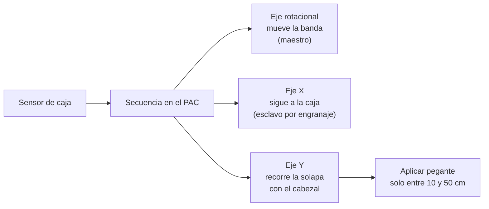
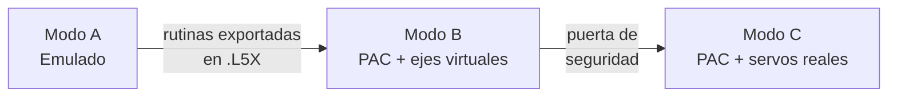

# Parte 2 · Etiquetadora de cajas: PAC físico, tres servomotores y gemelo digital

[← Proyecto Integrador Industrial](../README.md)

En la Parte 1 el controlador era emulado y los ejes eran virtuales. Aquí programas **desde cero** el PAC CompactLogix del laboratorio y **tres servomotores reales**, y conectas el gemelo digital de la máquina al mismo PAC. El resultado esperado: lo que hacen los servos se ve en el gemelo, y una orden dada desde el gemelo (mover un eje a cierta velocidad) mueve el servo real.

## La máquina

Una estación de aplicación de pegante "al vuelo" sobre las solapas de cajas que avanzan por una banda transportadora (en las guías de 2015 se le llama *etiquetadora de cajas*). Tiene tres ejes:

1. La banda avanza a velocidad constante.
2. El sensor detecta una caja.
3. El eje X se **engrana electrónicamente** a la banda para que el cabezal viaje a la misma velocidad que la caja.
4. Al mismo tiempo, el eje Y cruza la solapa; el pegante se aplica solo en una ventana de su recorrido.
5. X e Y regresan a su posición inicial y esperan la siguiente caja.

Detalle en la [guía 02](02-la-maquina-y-la-estacion.md).

## Tres modos de trabajo

El mismo programa recorre tres modos. Así se avanza en casa y se usa el tiempo de laboratorio para lo que de verdad necesita los motores.

| Modo | Dónde | Controlador | Ejes | Gemelo | Para qué |
| --- | --- | --- | --- | --- | --- |
| **A · Emulado** | Tu computador (VM) | Logix Emulate | `AXIS_VIRTUAL` | Conectado por OPC DA | Escribir y depurar la lógica completa |
| **B · PAC con ejes virtuales** | Laboratorio | 1769-L30ERM | `AXIS_VIRTUAL` | Conectado por OPC DA | Probar en el hardware real sin energizar motores |
| **C · PAC con servos** | Laboratorio | 1769-L30ERM | `AXIS_CIP_DRIVE` con Kinetix 350 | Espejo y mando | Puesta en marcha y validación final |

## Guías

| # | Guía | Modo | Basada en |
| --- | --- | --- | --- |
| 01 | [Seguridad y reglas de la estación](01-seguridad-y-reglas.md) | — | Nueva |
| 02 | [La máquina y la estación del laboratorio](02-la-maquina-y-la-estacion.md) | — | Guías 2015: 0, 1 y 6 |
| 03 | [Proyecto, E/S, drives y ejes en Studio 5000](03-proyecto-y-hardware.md) | B, C | Guías 2015: 1 y 2 |
| 04 | [Puesta en marcha de los ejes](04-puesta-en-marcha-de-ejes.md) | C | Guía 2015: 3 |
| 05 | [Estados, paradas y fallas](05-estados-paradas-y-fallas.md) | A, B, C | Guía 2015: 4 |
| 06 | [Movimientos básicos](06-movimientos-basicos.md) | A, B, C | Guía 2015: 5 |
| 07 | [Gemelo digital conectado al PAC](07-gemelo-conectado-al-pac.md) | A, B, C | Nueva |
| 08 | [Secuencia coordinada de la etiquetadora](08-secuencia-coordinada.md) | A, B, C | Guía 2015: 6 |

Plantilla: [contrato de señales entre el gemelo y el PAC](plantillas/contrato-de-senales.csv).

## Estado del material

> [!NOTE]
> - **Gemelo de la etiquetadora:** el modelo base en NX MCD está en preparación por el curso. La [guía 07](07-gemelo-conectado-al-pac.md) especifica qué debe contener y qué señales intercambia, para que el programa del PAC pueda escribirse desde ya.
> - **Versiones:** confirma con el monitor la versión de Studio 5000 de los computadores del laboratorio y el firmware de los PAC. Un proyecto solo se descarga a un controlador con la misma revisión mayor.
> - Las guías de 2015 se revisaron y corrigieron. Las correcciones técnicas están señaladas en cada guía con una nota.
