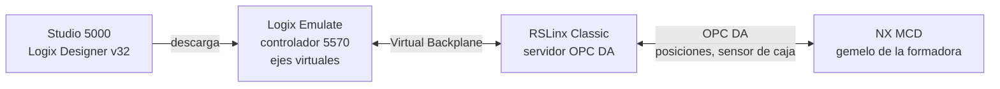
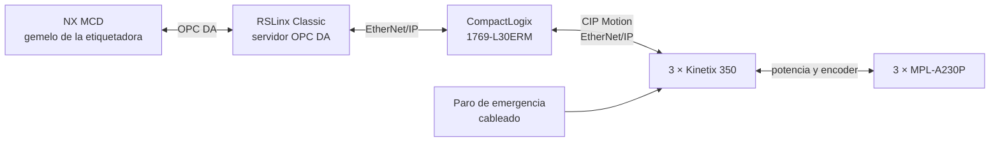

# Proyecto Integrador Industrial · Control de movimiento con gemelo digital

[← Inicio del repositorio](../README.md)

En este proyecto vas a llevar una máquina de tres ejes desde su especificación (Grafcet) hasta su programación en Ladder en un controlador Allen-Bradley, y a validarla con su gemelo digital en Siemens NX MCD y con las tendencias (Trends) de Studio 5000. El enfoque es **aprendizaje basado en problemas orientado a proyectos (PBL)**: la guía da la estructura, y las decisiones de ingeniería y su justificación las toma el equipo.

## Las dos partes

| | Parte 1 · Formadora de cajas | Parte 2 · Etiquetadora de cajas |
| --- | --- | --- |
| Pregunta | ¿Qué perfiles de movimiento permiten formar el mayor número de cajas por minuto sin perder la coordinación? | ¿Cómo se lleva una secuencia de 3 ejes a servos reales y se mantiene sincronizada con su gemelo? |
| Controlador | Logix Emulate (controlador emulado 5570) | CompactLogix 1769-L30ERM físico |
| Ejes | Y (lineal), X y Z (rotación), banda | Banda (rotacional), X (seguimiento), Y (cabezal) |
| Programa | Base entregada; se completan **Formado** y **Home** | Desde cero |
| Gemelo | Entregado: `000 - CASE ERECTOR CYBER PHYSICAL SYSTEM` | Modelo de la Etiquetadora (ver [Parte 2](02-etiquetadora-de-cajas/README.md)) |
| Comunicación | OPC DA a través de RSLinx Classic | OPC DA a través de RSLinx Classic, ahora hacia el PAC físico |

### Arquitectura de la Parte 1 (todo dentro de la máquina virtual)

### Arquitectura de la Parte 2 (laboratorio)

En ambos casos **el controlador es la única autoridad sobre los ejes**. El gemelo envía señales (sensores, solicitudes) y muestra las posiciones reales; nunca comanda directamente un motor.

## Ruta de trabajo

- [ ] **Instalación** · [00-instalacion](00-instalacion/README.md)
  - [ ] Descargar y descomprimir la máquina virtual
  - [ ] Abrir el programa base en Studio 5000 y descargarlo a Logix Emulate
  - [ ] Ver los tags en OPC Test Client
  - [ ] Abrir el gemelo en NX y verificar la licencia
- [ ] **Parte 1 · Formadora de cajas** · [01-formadora-de-cajas](01-formadora-de-cajas/README.md)
  - [ ] Elegir y justificar el ritmo de producción
  - [ ] Calcular los perfiles trapezoidales de cada eje y cada etapa
  - [ ] Completar las rutinas `B_Process_Formado` y `C_Process_Home`
  - [ ] Validar con el gemelo y con Trends
- [ ] **Parte 2 · Etiquetadora de cajas** · [02-etiquetadora-de-cajas](02-etiquetadora-de-cajas/README.md)
  - [ ] Inducción de seguridad
  - [ ] Configurar el proyecto, drives, ejes y escalado
  - [ ] Poner en marcha cada eje (hook-up, polaridad, sintonía)
  - [ ] Programar paradas, movimientos básicos y la secuencia coordinada
  - [ ] Conectar el gemelo al PAC físico y validar el movimiento conjunto
- [ ] **Entregables** · [entregables-y-evaluacion.md](entregables-y-evaluacion.md)

## Cronograma 2026-2S

Fechas tomadas del programa de la asignatura. Las sesiones de la Parte 2 se programan con el docente.

| Semana | Fecha | Sesión |
| --- | --- | --- |
| 12 | Jue 12 nov | Control industrial 1/4: arquitectura PLC/PAC, servo drive, motor, encoder; especificación secuencial con Grafcet |
| 12 | Vie 13 nov | Control industrial 2/4: de Grafcet a Ladder; estados, transiciones, enclavamientos y secuencias de la formadora de cajas |
| 13 | Jue 19 nov | Control industrial 3/4: laboratorio Studio 5000; configuración, ejes e instrucciones de movimiento en Ladder |
| 13 | Vie 20 nov | Control industrial 4/4: integración controlador–gemelo digital; puesta en marcha virtual |
| — | Por definir | Parte 2: sesiones en el laboratorio 411-101 por equipos |
| Cierre | Mar 15 dic | Entrega del documento del Proyecto Industrial |

> [!TIP]
> Instala la máquina virtual **antes** de la semana 12. Son 37 archivos comprimidos y la descompresión toma tiempo; los problemas de instalación se resuelven mejor con anticipación.

## Archivos que necesitas

Los archivos pesados se distribuyen por Google Classroom y no están en este repositorio.

| Archivo | Dónde | Para qué |
| --- | --- | --- |
| `VM_DIGITAL-TWIN_WIN10X64.zip.001` … `.037` | Classroom (dos carpetas compartidas: partes 1–20 y 21–37) | Máquina virtual con todo el software |
| `VMware-player-full-16.2.5-20904516.exe` | Classroom | Ejecutar la máquina virtual |
| `BOX_FORMING_LADDER_RS32_logixEmulate.ACD` | Classroom, carpeta *Proyecto Industrial* | Programa Ladder base de la formadora |
| `000 - CASE ERECTOR CYBER PHYSICAL SYSTEM` | Dentro de la VM: `Documentos\BOX_FORMING_CPS_CONTROL_EMULATED\BOX_FORMING_DIGITAL_TWIN-NX-12_V0.5` | Gemelo digital de la formadora |
| *Logix 5000 Controllers Motion Instructions* (MOTION-RM002) | Classroom o [Rockwell Literature Library](https://literature.rockwellautomation.com) | Manual de referencia de MAM, MAS, MAJ, MAH, MAG |

## Equipos de trabajo

- Cada equipo registra a sus integrantes y el PAC asignado (número e IP del tablero) antes de la primera sesión de la Parte 2.
- Se recomienda versionar el trabajo: exporta las rutinas como `.L5X` (texto) además del `.ACD` (binario) para poder revisar cambios entre versiones.

## Material de apoyo

- [Referencias y material original](recursos/referencias.md)
- [Glosario](recursos/glosario.md)
